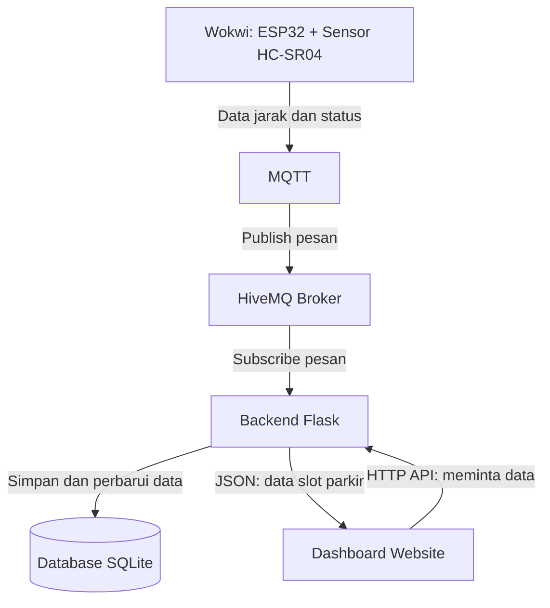

# ParkirKu - Smart Parking Monitoring

## 1. Deskripsi Proyek

ParkirKu merupakan sistem monitoring tempat parkir berbasis IoT yang bertujuan untuk membantu pengguna mengetahui ketersediaan slot parkir secara lebih mudah.

Sistem ini memungkinkan pengguna melihat jumlah slot parkir, jumlah slot kosong, jumlah slot terisi, serta kondisi setiap slot melalui website dashboard.

## 2. Tujuan Proyek

- Memudahkan pengguna mengetahui ketersediaan tempat parkir.
- Menampilkan informasi kondisi setiap slot secara langsung dari data sistem.
- Menyimpan status dan riwayat perubahan kondisi parkir.
- Mengurangi kesulitan pengguna dalam mencari tempat parkir kosong.

## 3. Fitur Utama

- Menampilkan jumlah seluruh slot parkir.
- Menampilkan jumlah slot kosong dan terisi.
- Menampilkan status masing-masing slot.
- Menyimpan riwayat perubahan status parkir.
- Menampilkan informasi parkir melalui dashboard website.

## 4. Teknologi yang Digunakan

- Python: Bahasa pemrograman utama untuk menjalankan sistem backend.
- Flask: Framework Python untuk membangun backend dan API.
- SQLite: Database untuk menyimpan data slot parkir dan riwayat perubahan status.
- HTML: Membuat struktur halaman dashboard website.
- CSS: Mengatur tampilan dan desain dashboard.
- JavaScript: Mengatur interaksi dan pembaruan informasi pada dashboard.
- ESP32: Mikrokontroler yang digunakan untuk memproses data sensor.
- HC-SR04: Sensor ultrasonik untuk mendeteksi jarak kendaraan pada slot parkir.
- Wokwi: Platform simulasi ESP32 dan sensor ultrasonik.
- MQTT: Protokol komunikasi untuk mengirimkan data dari perangkat IoT ke backend.
- HiveMQ: Broker MQTT yang digunakan sebagai perantara pengiriman data sensor.

## 5. Alur Kerja Sistem

ParkirKu terdiri dari beberapa komponen yang saling terhubung, yaitu perangkat IoT, broker MQTT, backend, database, dan frontend.
1. ESP32 atau simulator Wokwi membaca kondisi slot parkir melalui sensor HC-SR04.
2. Data kondisi parkir dikirimkan melalui protokol MQTT ke HiveMQ Broker.
3. Backend Flask menerima pesan dari broker MQTT melalui MQTT Subscriber.
4. Backend memvalidasi data dan meneruskannya ke pengelola database.
5. Database SQLite menyimpan status terbaru slot dan riwayat perubahan status.
6. Frontend mengambil informasi dari backend melalui API.
7. Dashboard menampilkan jumlah slot kosong, slot terisi, dan status setiap slot kepada pengguna.

## 6. Struktur Proyek

## 7. Instalasi
Langkah instalasi
1. Clone repository: git clone https://github.com/fawwazkazim107/ParkirKu.git
2. Masuk ke direktori proyek: cd ParkirKu
3. Buat virtual environment: python -m venv venv
4. Aktifkan virtual environment.
Windows: venv\Scripts\activate
5. Instal dependency: pip install -r requirements.txt
6. Jalankan backend: python app.py
7. Buka browser dan akses: http://127.0.0.1:5000
8. Jalankan simulasi ESP32 pada Wokwi untuk mengirim data sensor melalui MQTT.
   
## 8. Penjelasan Komponen Sistem
### 8.1 Backend
Backend dikembangkan menggunakan Python dan Flask.
- Menyediakan halaman dashboard website.
- Menyediakan HTTP API untuk mengambil data slot parkir.
- Menerima pesan MQTT dari broker HiveMQ.
- Memproses data sensor yang diterima.
- Memperbarui status parkir melalui fungsi pada ParkingManager.
- Menyediakan data ringkasan dan riwayat parkir.

### 8.2 Database
Database menggunakan SQLite untuk menyimpan data slot parkir dan riwayat perubahan status.
Terdapat dua tabel utama:

Tabel parking_slots

Menyimpan informasi slot parkir, meliputi:
- ID slot.
- Kode slot, seperti A1 dan B1.
- Lokasi atau area parkir.
- Status slot, yaitu Kosong atau Terisi.

Tabel parking_logs

Menyimpan riwayat perubahan status parkir, meliputi:
- ID riwayat.
- ID slot yang mengalami perubahan.
- Status terbaru.
- Waktu perubahan status.
- Riwayat dicatat ketika status slot benar-benar berubah.

### 8.3 Frontend
Frontend dikembangkan menggunakan HTML, CSS, dan JavaScript yang terdapat pada file templates/index.html.

Frontend bertanggung jawab untuk menampilkan informasi kondisi parkir kepada pengguna melalui website dashboard.
Fitur frontend:
1. Ringkasan Ketersediaan Slot
Menampilkan jumlah slot kosong dari keseluruhan slot parkir. Informasi akan berubah mengikuti data terbaru dari backend.
2. Daftar Slot Berdasarkan Area
Menampilkan kartu slot parkir yang dibagi menjadi Area A dan Area B.
3. Indikator Status Slot
Menggunakan warna untuk memudahkan pengguna mengetahui kondisi parkir:
   - Hijau: Slot Kosong.
   - Merah dengan ikon mobil: Slot Terisi.
4. Grafik Statistik Parkir
Menampilkan grafik batang yang menunjukkan jumlah slot terisi pada setiap area parkir menggunakan Chart.js.
5. Auto-Refresh Data
Dashboard mengambil data terbaru dari backend secara otomatis setiap 5 detik tanpa perlu melakukan refresh halaman secara manual.
6. Responsive Design
Tata letak dashboard dibuat agar dapat menyesuaikan ukuran layar komputer maupun HP.

Konfigurasi frontend (konfigurasi dan keterangan):
- File utama        : templates/index.html
- Sumber data       : Endpoint /api/slots
- Interval pembaruan: setInterval(muatSlot, 5000)
- Status kosong     : Class CSS .Kosong
- Status terisi     : Class CSS .Terisi
- Ikon mobil        : Class CSS .mobil
- Grafik            : Chart.js melalui CDN

### 8.4 IoT dan Integrasi MQTT
Bagian IoT dikembangkan menggunakan ESP32 dengan simulator Wokwi dan sensor ultrasonik HC-SR04.
- Membuat simulasi perangkat keras menggunakan ESP32.
- Menghubungkan ESP32 dengan sensor ultrasonik HC-SR04.
- Membaca jarak objek pada setiap slot parkir.
- Menentukan status parkir berdasarkan hasil pembacaan sensor.
- Mengirimkan data status parkir ke backend melalui protokol MQTT.

Konfigurasi MQTT:
- Broker            = broker.hivemq.com
- Port              = 1883
- Topic             = parkirku/kelompok3/sensor
- Format data       = JSON
- Platform simulasi = Wokwi
- Mikrokontroler    = ESP32

## 9. Cara Menjalankan Aplikasi

(Petunjuk menjalankan backend dan dashboard akan dilengkapi setelah implementasi selesai.)
Demo dilakukan untuk memperlihatkan perubahan status parkir dari simulasi IoT hingga dashboard website.
### Skenario 1: Kendaraan Masuk
1. Jalankan backend ParkirKu.
2. Jalankan simulasi ESP32 pada Wokwi.
3. Buka dashboard website.
4. Pilih sensor slot A1 pada simulator.
5. Ubah jarak menjadi 5 cm.
6. ESP32 mengirim status Terisi melalui MQTT.
7. Backend menerima data dan memperbarui database.
8. Dashboard menampilkan slot A1 sebagai Terisi.

### Skenario 2: Kendaraan Keluar
1. Ubah jarak sensor A1 menjadi 50 cm.
2. ESP32 mengirim status Kosong melalui MQTT.
3. Backend memperbarui status slot pada database.
4. Dashboard menampilkan slot A1 sebagai Kosong.

Keterangan warna pada dashboard mengikuti implementasi frontend.

## 10. Pengujian

Bagian ini berisi skenario dan hasil pengujian API, database, dashboard, simulator, dan integrasi sistem.

## 11. Tim Pengembang
- Fawwaz - Database
- Alif - Backend
- Ardhy - Frontend
- Ucup - IoT dan Wokwi
- Anis - Dokumentasi dan Presentasi
